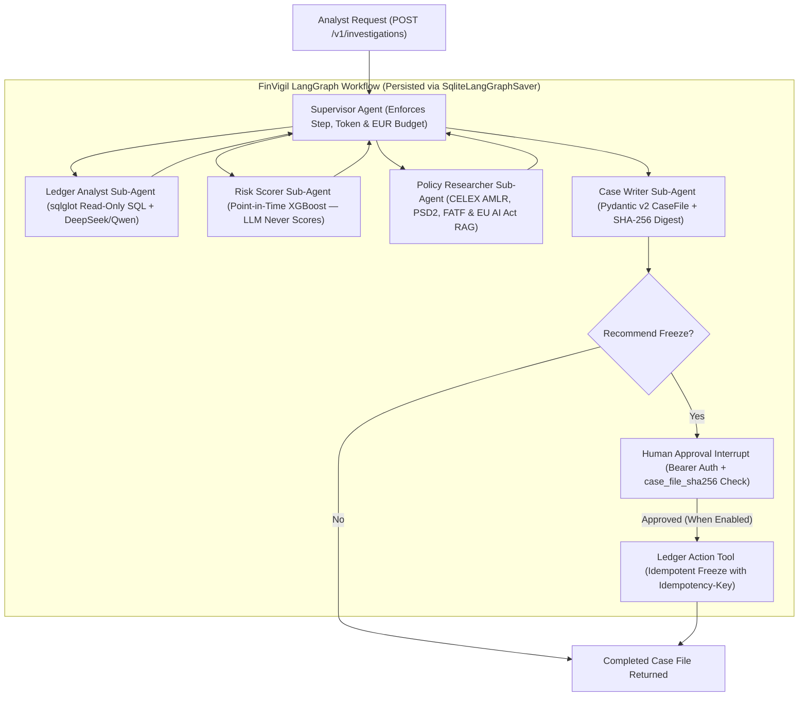

# FinVigil — Autonomous AML & Fraud Investigation Engine

[](pyproject.toml)
[](evals/runner.py)
[](src/finvigil/agents/budget.py)
[](src/finvigil/llm.py)

**FinVigil** (*Financial Vigil*) is a Python 3.12 AML and fraud investigation system over an integer-cent double-entry bank ledger. It pairs a `sqlglot`-guarded read-only SQL tool and a point-in-time **XGBoost** classifier with open-source Chinese LLMs (**DeepSeek-R1 / DeepSeek-V3** and **Alibaba Qwen 2.5** via Ollama or OpenAI-compatible endpoints), SQLite-persisted **LangGraph** checkpoints, and authenticated, SHA-256 case-bound human approval.

> [!IMPORTANT]
> **V1 Read-Only Default (`FINVIGIL_ENABLE_FREEZE_ACTIONS=false`)**
> By default, FinVigil runs in **strictly read-only assessment mode**: it queries the ledger via a read-only connection, computes a point-in-time deterministic XGBoost score (`as_of_step`), and returns a cited `CaseFile` with a cryptographic `case_file_sha256` digest. Account freeze execution is disabled unless `FINVIGIL_ENABLE_FREEZE_ACTIONS=true` and an authenticated compliance officer (`Authorization: Bearer <token>`) approves the exact `case_file_sha256`.

---

## Architecture



---

## Open-Source LLM Configuration (DeepSeek & Alibaba Qwen)

FinVigil's LLM client ([`src/finvigil/llm.py`](src/finvigil/llm.py)) natively supports **DeepSeek-R1 / DeepSeek-V3** (automatically stripping and recording `<think>...</think>` reasoning blocks) and **Qwen 2.5**:

```bash
# Option A (Default): Local Open-Source Alibaba Qwen 2.5 7B or DeepSeek-R1 via Ollama (100% Free)
ollama pull qwen2.5:7b   # or: ollama pull deepseek-r1:8b
export FINVIGIL_LLM_PROVIDER=ollama
export FINVIGIL_LLM_BASE_URL=http://localhost:11434/v1
export FINVIGIL_LLM_MODEL=qwen2.5:7b

# Option B: DeepSeek Official API (DeepSeek-V3 / DeepSeek-R1)
export FINVIGIL_LLM_PROVIDER=deepseek
export FINVIGIL_LLM_BASE_URL=https://api.deepseek.com/v1
export FINVIGIL_LLM_MODEL=deepseek-chat
export FINVIGIL_LLM_API_KEY=sk-...

# Option C: Alibaba Cloud Qwen (DashScope OpenAI-Compatible Endpoint)
export FINVIGIL_LLM_PROVIDER=qwen
export FINVIGIL_LLM_BASE_URL=https://dashscope-intl.aliyuncs.com/compatible-mode/v1
export FINVIGIL_LLM_MODEL=qwen-plus
export FINVIGIL_LLM_API_KEY=sk-...
```

---

## Evaluation Benchmarks (60-Case Holdout Suite & Chronological Splits)

All figures below match the exact output of `.venv/bin/python -m ml.train` and `.venv/bin/python -m evals.runner`:

| Benchmark / Metric | Result | Notes / Split Strategy |
| :--- | :--- | :--- |
| **60-Case Eval Suite Pass Rate** | **93.33% (56/60)** | 10 curated golden + 20 `LAYERING_MULE` typology holdouts + 30 benign/hard-negative holdouts |
| **60-Case Eval Precision / Recall** | **92.31% / 92.31%** | Confusion Matrix: `TP=24, FP=2, TN=32, FN=2` |
| **XGBoost Chronological Holdout (`step > 590h`)** | **F1: 0.9714 (Recall: 94.44%)** | Point-in-time `as_of_step` features; Brier calibration loss `0.0060` |
| **XGBoost Unseen Typology Holdout (`LAYERING_MULE`)** | **F1: 0.9720 (PR-AUC: 0.9865)** | Trained excluding `LAYERING_MULE`; Brier calibration loss `0.0180` |
| **Prompt-Injection Defense Rate** | **100.0%** | Adversarial `<untrusted_transaction_memo>` payloads neutralized |
| **Avg Tokens / Cost per Investigation** | **2,370.4 tokens / €0.001144** | Measured BPE token counts at DeepSeek-V3 / Qwen pricing |

---

## Security & Production Engineering Guarantees

1. **Safe SQL Generation ([`sql_guard.py`](src/finvigil/tools/sql_guard.py))**: Parses every query with `sqlglot`, enforces single-statement `SELECT`-only ASTs, checks tables against `{"accounts", "journal_entries", "postings", "transactions", "aml_alerts"}`, blocks `is_fraud_label` and dangerous functions (`pg_sleep`, `pg_read_file`), clamps `LIMIT <= 100`, and executes inside a read-only transaction with a `2000ms` timeout.
2. **Point-in-Time Determinism ([`features.py`](ml/features.py) & [`risk_model.py`](src/finvigil/tools/risk_model.py))**: Ledger balances and postings use integer minor units (`amount_cents`, `balance_cents`). Feature extraction enforces `step_hour <= as_of_step` to prevent future leakage.
3. **Authenticated, Case-Bound Human Approval ([`auth.py`](src/finvigil/auth.py) & [`app.py`](src/finvigil/api/app.py))**: `/v1/investigations/{case_id}/approve` requires a valid `Authorization: Bearer <token>`, derives the `reviewer` identity strictly from the verified token, requires an explicit `decision` (`"APPROVE"` or `"REJECT"` with no default), and verifies `case_file_sha256` in constant time (`409 Conflict` on mismatch).
4. **True Subprocess-Durable LangGraph Checkpointing ([`checkpointer.py`](src/finvigil/agents/checkpointer.py))**: `SqliteLangGraphSaver` subclasses LangGraph's `BaseCheckpointSaver`, persisting checkpoints to SQLite in WAL mode and resuming natively via `graph.update_state(config, ...)` + `graph.invoke(None, config=config)` across separate OS processes (verified via `subprocess.run` tests).
5. **Java 21 `payments-lab` (`ledger_sentinel_ai`) Read-Only Bridge ([`ledger_client.py`](src/finvigil/ledger_client.py))**: Connects directly in read-only mode to the Java 21 `payments-lab` PostgreSQL 18 schema (`127.0.0.1:55432/payments` via `sync_from_java_ledger_postgres` or `POST /v1/ledger/sync-java`) and OpenAPI 3.1 HTTP endpoints (`/v1/accounts/{accountId}`, `/v1/accounts/{accountId}/entries`, `/v1/transfers/{transferId}` via `JavaLedgerReadOnlyClient`).

---

## Quickstart

```bash
# 1. Seed the 600-account integer-cent ledger and train the chronological XGBoost model
.venv/bin/python -m data.seed_ledger
.venv/bin/python -m ml.train

# 2. Run the test suite (including multi-process restart tests) and the 60-case Eval Gate
.venv/bin/pytest -v
.venv/bin/python -m evals.runner

# 3. Start the FastAPI server locally (defaults to v1 read-only mode)
.venv/bin/uvicorn finvigil.api.app:app --reload --port 8000
```
